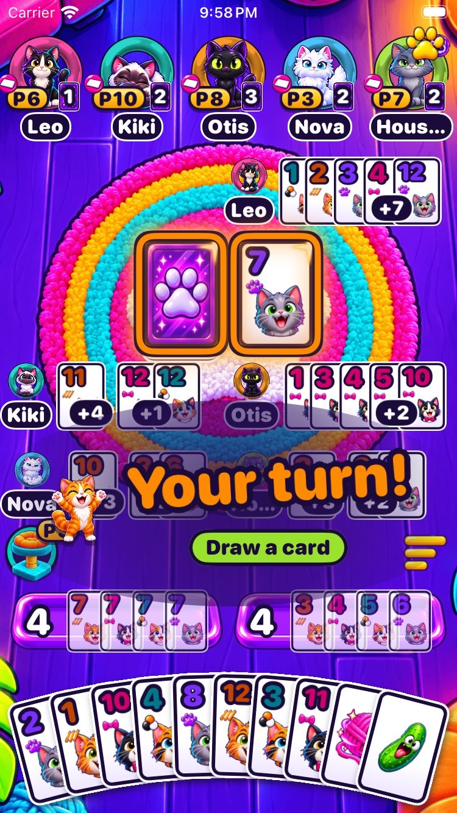
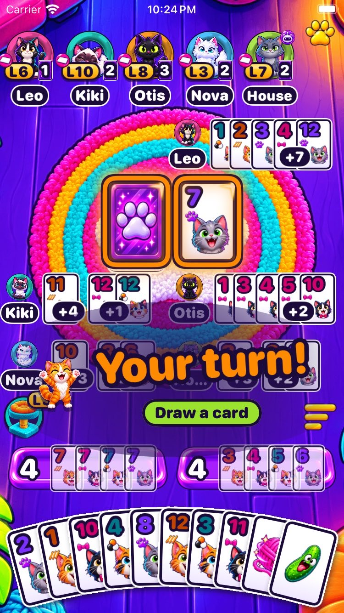
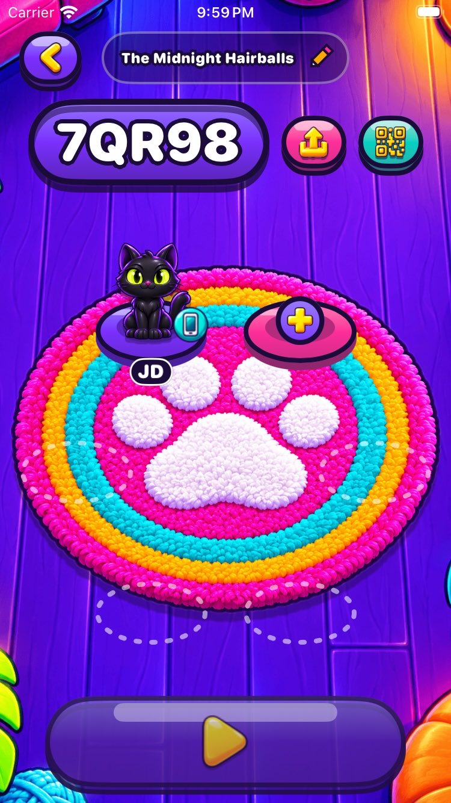
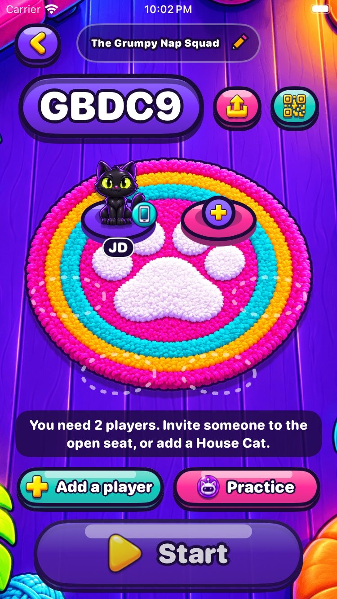
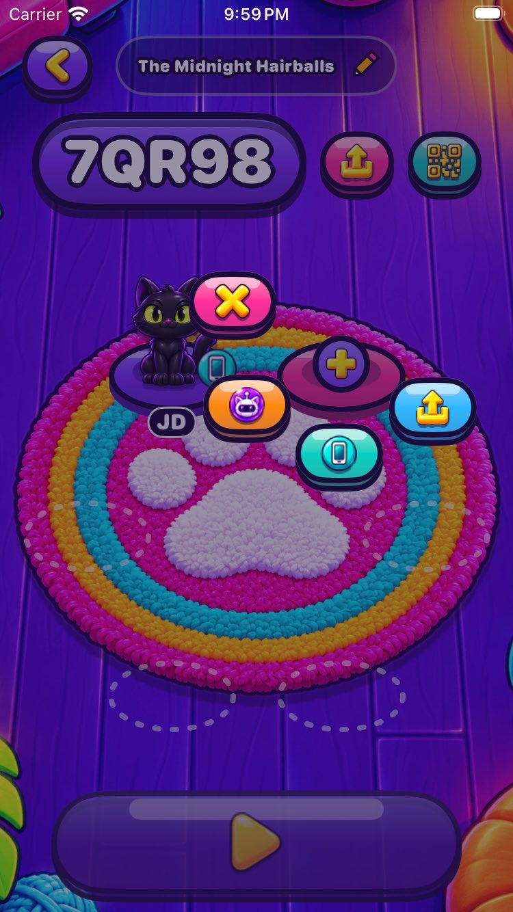
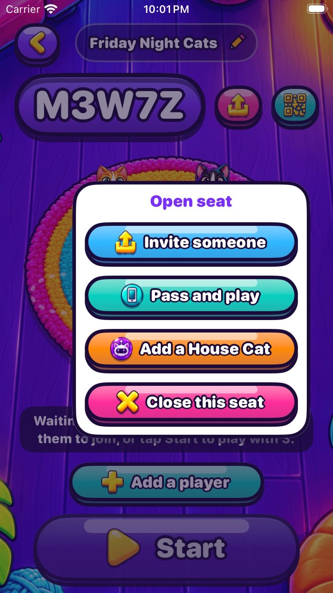
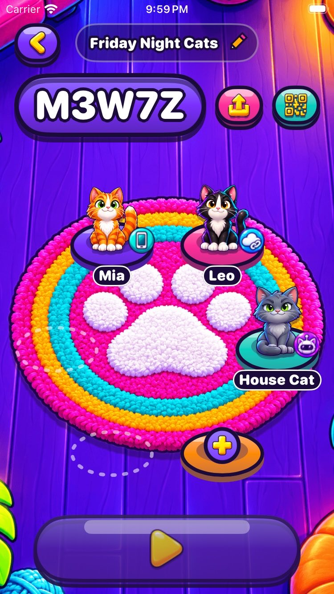
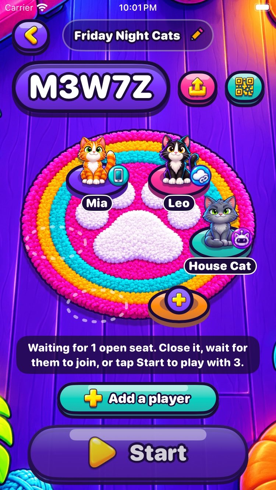
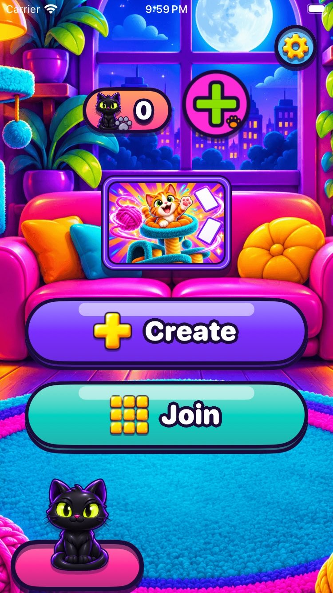
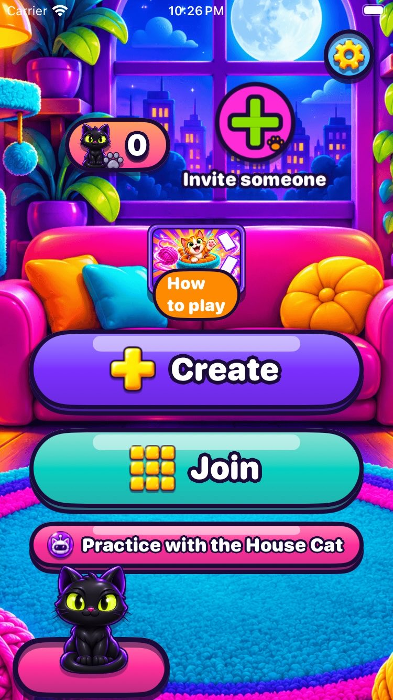

# Table and lobby launch fixes

iPhone SE (3rd generation, 375 x 667 pt), iOS 26.2. `before/` is `origin/main` at ff2ca3f.

## Table

| | Before | After |
|---|---|---|
| Six players: the paw menu lay over the last cat and took its tap; "Hou..." |  |  |

1. **Refused moves say why.** One line above the trays for about four seconds, never blocking play:
   a reason worked out on the phone ([table-move-note](after/table-move-note.jpg)) or from the
   server's error code ([table-server-refusal](after/table-server-refusal.jpg)). A pile that can't
   be drawn from used to do nothing at all; now it says why too.
2. **Discard has an Undo.** The card goes to the pile and waits three seconds under an Undo pill
   ([table-discard-undo](after/table-discard-undo.jpg)); the discard is sent when the window
   closes, when the app goes to the background or when the table is left. Nothing reaches the
   server before that, so Undo needs no server support and can't race another player.
3. **Paw menu.** On a phone with a short status bar the cats share the width left of the paw from
   three cats up; where touch targets still overlap, the nearer center wins.
4. **Names and chips.** A long name gets smaller type before it is cut, and is cut at a word
   ("House Cat" becomes "House", "House Cat 2" becomes "House 2"). Name pills, card counts and
   level chips grow with the text size setting as far as each cat's slot allows:
   [six players](after/table-6-players-system-large-text.jpg),
   [two players](after/table-2-players-large-text.jpg).
5. **Gesture tips, once each:** [tap a cat](after/tip-tap-a-cat.jpg) (after a first whole turn, on
   someone else's turn), swipe home (same), [tap the tower again for scores](after/tip-scores.jpg)
   (when the tower is open), and on Home "Press and hold a table to archive it".
6. **Not playing.** A phone that forfeited, or arrives after the deal, gets a title and an
   explanation: [started](after/not-playing-started.jpg), [forfeited](after/not-playing-forfeited.jpg),
   [large text](after/not-playing-large-text.jpg).

## Lobby

| | Before | After |
|---|---|---|
| A new table |  |  |
| The seat menu |  |  |
| Waiting on an open seat |  |  |
| Empty Home |  |  |

7. The status line says what the table is waiting for. "Add a player" opens the next free seat's
   choices, all worded. Start with seats still open and two or more cats asks
   ["Start with 3 players?"](after/lobby-start-confirm.jpg) and closes the empty seats.
   [Large text](after/lobby-large-text.jpg).
8. "Practice" in the lobby (alone at the table) and "Practice with the House Cat" on an empty
   Home seat a House Cat and start at once.
